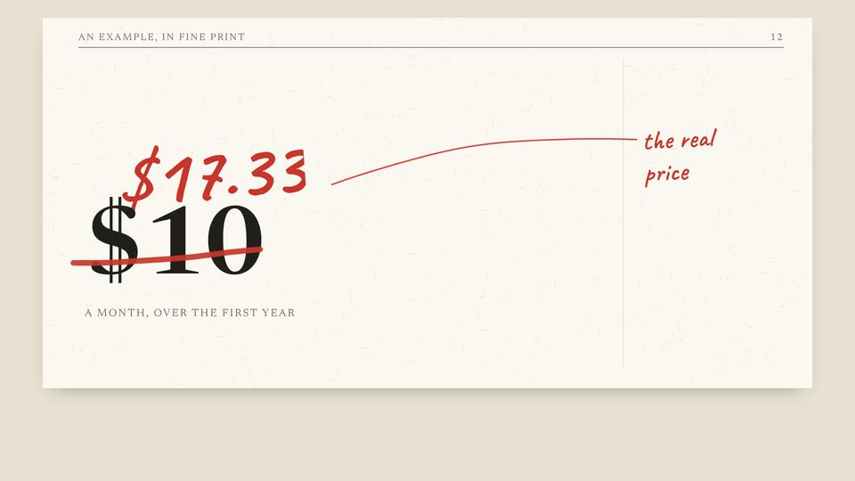
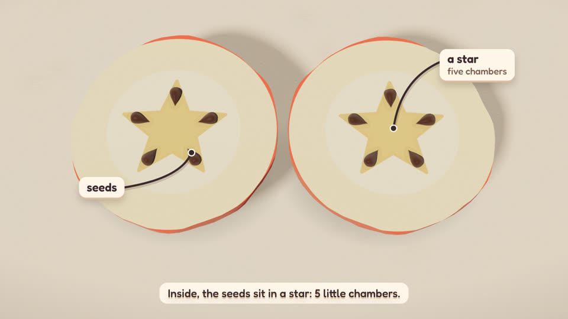
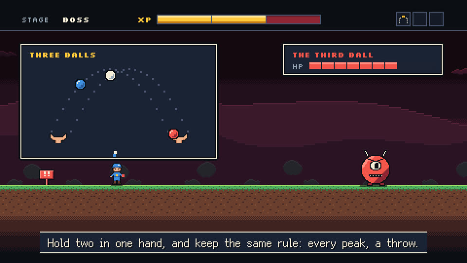
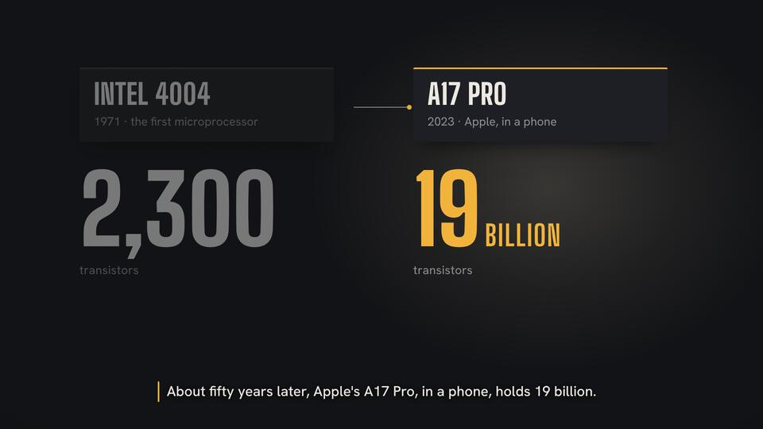
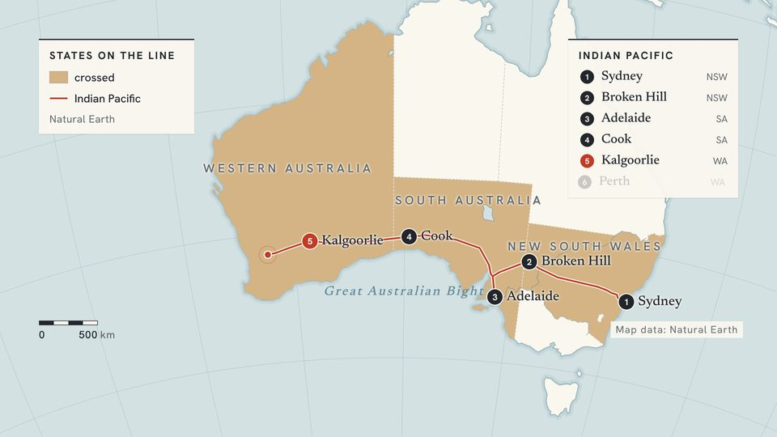
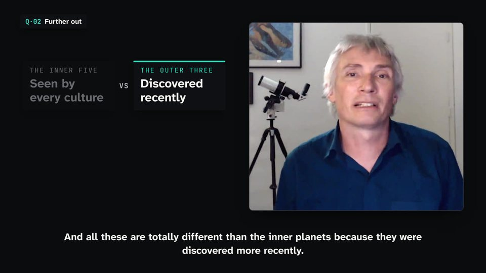

<div align="center">

<h1>
  <picture>
    <source media="(prefers-color-scheme: dark)" srcset="https://motionhub.dev/brand/logo-dark.svg">
    
  </picture>
</h1>

**Reusable looks for narrated and explanatory video.**<br>
An open format and a public catalogue: how a film looks and how it moves, written so that a person or an agent can make a new film in it with any engine.

**English** · [简体中文](README.zh-CN.md)

**[Browse the motions](https://motionhub.dev)** · [Docs](https://motionhub.dev/docs/) · [Specification](SPEC.md)

[](https://www.npmjs.com/package/@motionhub/cli)
[](https://github.com/motionhub-dev/motions/actions/workflows/check.yml)
[](SPEC.md)
[](LICENSE)

<table>
<tr>
<td width="25%" align="center"><a href="https://motionhub.dev/m/@iamsuosi/red-pencil/"></a><br><sub>Red Pencil</sub></td>
<td width="25%" align="center"><a href="https://motionhub.dev/m/@iamsuosi/clay-world/"></a><br><sub>Clay World</sub></td>
<td width="25%" align="center"><a href="https://motionhub.dev/m/@iamsuosi/ink-scroll/"></a><br><sub>Ink Scroll</sub></td>
<td width="25%" align="center"><a href="https://motionhub.dev/m/@iamsuosi/pixel-quest/"></a><br><sub>Pixel Quest</sub></td>
</tr>
<tr>
<td width="25%" align="center"><a href="https://motionhub.dev/m/@iamsuosi/stage-light/"></a><br><sub>Stage Light</sub></td>
<td width="25%" align="center"><a href="https://motionhub.dev/m/@iamsuosi/field-atlas/"></a><br><sub>Field Atlas</sub></td>
<td width="25%" align="center"><a href="https://motionhub.dev/m/@iamsuosi/riso-pop/"></a><br><sub>Riso Pop</sub></td>
<td width="25%" align="center"><a href="https://motionhub.dev/m/@iamsuosi/on-air/"></a><br><sub>On Air</sub></td>
</tr>
</table>

[**Browse every motion on motionhub.dev**](https://motionhub.dev)

</div>

## What a motion is

Every motion is written around a [`MOTION.md`](docs/motion-md.md), an open format that works like a `SKILL.md`: one file says how a film looks and moves, and a directory around it can bring ready-made components for your agent to use first.

A motion holds a look and no film: its ground, colour and type, and how things arrive, change and leave. There is no story, script, scene or timing in it. You bring the story; the motion keeps the look, in whichever engine you use.

## Quick start

Nothing to install. Pick a motion, then paste this into any agent that can open a URL:

```text
Read https://motionhub.dev/llms.txt, then make a film about "<your topic>" in the motion @iamsuosi/red-pencil
```

To make it shorter, install the skill once, for every agent on your computer:

```sh
npx skills add motionhub-dev/motions -g
```

Then say what you want:

| Say | What happens |
|---|---|
| `/motionhub make a film about <your topic> in @iamsuosi/red-pencil` | The agent fetches the motion, checks it against its SHA-256, reads `MOTION.md` and `tokens.json` whole, and makes your film in its look with whatever engine it uses |
| `/motionhub make a Remotion film about <your topic> in @iamsuosi/clay-world` | The same, in Remotion, built from the motion's components and tokens |
| `/motionhub share this project's look as a motion` | The agent writes the motion from the project's look and never its story, runs the checks, shows you the result and opens the pull request only when you say yes |

Or from the command line, with Node.js 20 or later:

```sh
npx @motionhub/cli search hand-drawn          # motions with every word
npx @motionhub/cli get @iamsuosi/red-pencil   # into ./motion, checked against its SHA-256
```

[Use a motion](docs/use.md) has every way, and [Command line](docs/cli.md) every command.

## What a motion looks like

On motionhub a motion is a directory of five files, and a directory for each tool that wants ready-made pieces (for your own project, [one `MOTION.md` is enough](docs/motion-md.md#start-with-one-file)):

```
motions/@<scope>/<slug>/   a motion, id @<scope>/<slug>: its creator's GitHub name and its slug
  motion.json     its id, version, name, one line, authors and licence
  MOTION.md       the look in words, for people and agents: essence, colour, type, motion, what to avoid
  tokens.json     the exact values, as W3C design tokens: colours, faces, durations, easings
  poster.jpg      one frame of a film made in it
  CREDITS.md      every font and asset it needs, with its licence and source
  react/          optional: components that run unchanged in any React engine
```

```json
{
  "spec": "motion/0.4",
  "scope": "iamsuosi",
  "slug": "red-pencil",
  "version": "1.0.5",
  "name": {"en": "Red Pencil", "zh-CN": "红笔批注"},
  "line": {"en": "A printed page marked up in red as it is read: figures circled, wrong sums struck and corrected, verdicts written in the margin."},
  "authors": [{"name": "SuoSi", "github": "iamsuosi"}],
  "license": {"text": "CC-BY-4.0", "code": "MIT"},
  "lang": "en",
  "tags": ["hand-drawn", "light"],
  "fit": {"kind": "general", "for": {"en": "Checking a document line by line: what a price is made of, contract terms, claims in an ad, numbers corrected."}}
}
```

[SPEC.md](SPEC.md) says exactly what each file holds and what any tool can rely on.

## Engines

The same motion gives the same look in every engine.

| Engine | How a motion works in it | Guide |
|---|---|---|
| **Remotion** | Tokens become values, and the components in `react/` run unchanged through [`@motionhub/remotion`](packages/remotion/README.md) | [Remotion](docs/remotion.md) |
| **HyperFrames** | Tokens become CSS variables and eases, and the components in `react/` draw at your timeline's time through [`@motionhub/hyperframes`](packages/hyperframes/README.md) | [HyperFrames](docs/hyperframes.md) |
| **Anything else** | HTML and CSS, GSAP, Motion Canvas or a renderer of your own: follow `MOTION.md` and `tokens.json`, the way you would follow a design system | [Use a motion](docs/use.md#in-anything-else) |

Both bindings provide [`@motionhub/runtime`](packages/runtime/README.md), which is all a motion's components import besides React.

## Share a motion

Made a film whose look others should have? With the skill installed, ask your agent from that project:

```text
/motionhub share this project's look as a motion
```

By hand:

```sh
npx @motionhub/cli init <slug>         # ./<slug>/ with every required file to fill in, scoped to you
npx @motionhub/cli share <slug>        # the checks the pull request will run, as your GitHub account (gh)
npx @motionhub/cli share <slug> --pr   # the pull request, from your fork, signed off
```

Your motion is published as `@<your GitHub name>/<slug>`, and building on someone else's motion is welcome. [CONTRIBUTING.md](CONTRIBUTING.md) has what is accepted and how it is reviewed.

<details>
<summary><b>What is in this repository</b></summary>

| Path | |
|---|---|
| [SPEC.md](SPEC.md) | The motion format |
| [CONTRIBUTING.md](CONTRIBUTING.md) | How to add a motion, what is accepted and how it is reviewed |
| [HUB.md](HUB.md) | How the catalogue is published and fetched |
| [motions](motions) | The catalogue |
| [skills/motionhub](skills/motionhub/SKILL.md) | The agent skill: how to choose a motion, fetch it, make a film in it and share your own |
| [bin](bin) · [tools](tools) | `@motionhub/cli`, the checker that holds every rule, and the build of what motionhub.dev serves |
| [packages](packages) | `@motionhub/runtime` and its bindings for Remotion and HyperFrames |
| [docs](docs) | The guides at [motionhub.dev/docs](https://motionhub.dev/docs/) |
| [site](site) | The pages of motionhub.dev, an Astro project with its own dependencies |
| [brand](brand/BRAND.md) | The logo, the design tokens and how to use them |
| [tests](tests) | The tools' tests |

</details>

<details>
<summary><b>Develop</b></summary>

The repository's root is the zero-dependency `@motionhub/cli` package. Before pushing:

```sh
npm test                                  # the tools' tests
node tools/check.mjs                      # every motion
node tools/check.mjs motions/@<scope>/<slug>   # or one
node tools/build.mjs                      # the files motionhub.dev serves, into dist/
```

For a change to the site, in `site/`:

```sh
npm ci && npm run build
```

Every commit is signed off (`git commit -s`); the checks refuse a pull request without it.

</details>

## Status

Early. The format is a draft, and a new version adds to it without changing what a published version says. Proposals to change it are [issues](https://github.com/motionhub-dev/motions/issues) on this repository. The format belongs to everyone who uses it.

Maintained by [SuoSi](https://github.com/iamsuosi).

## License

The tools in this repository are [MIT](LICENSE)-licensed. Each motion carries its own licence in its `motion.json`.
