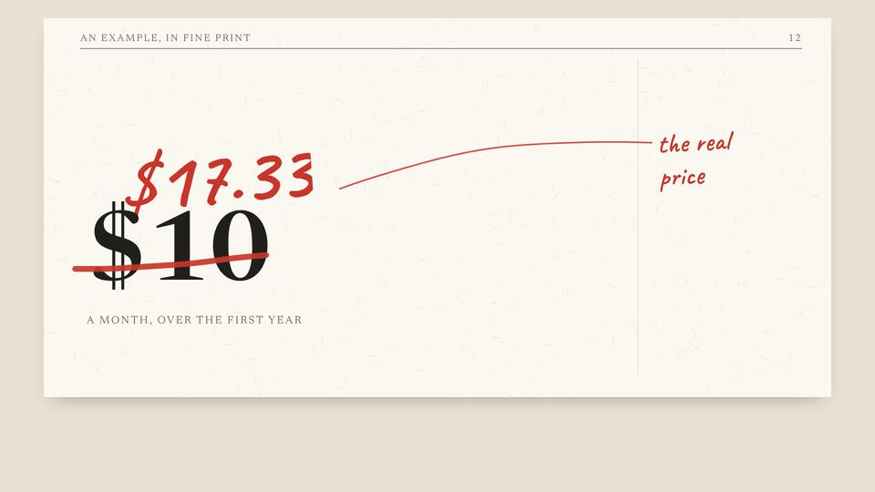
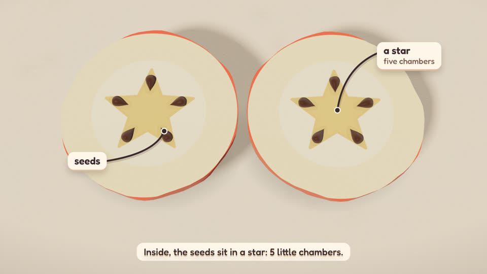
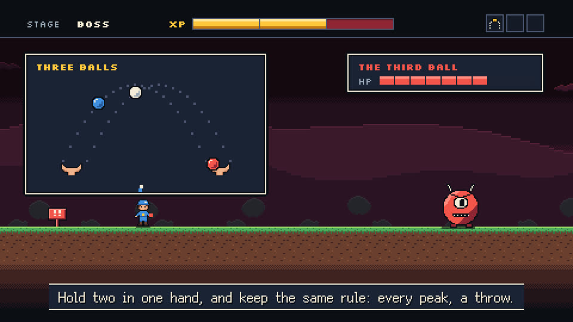
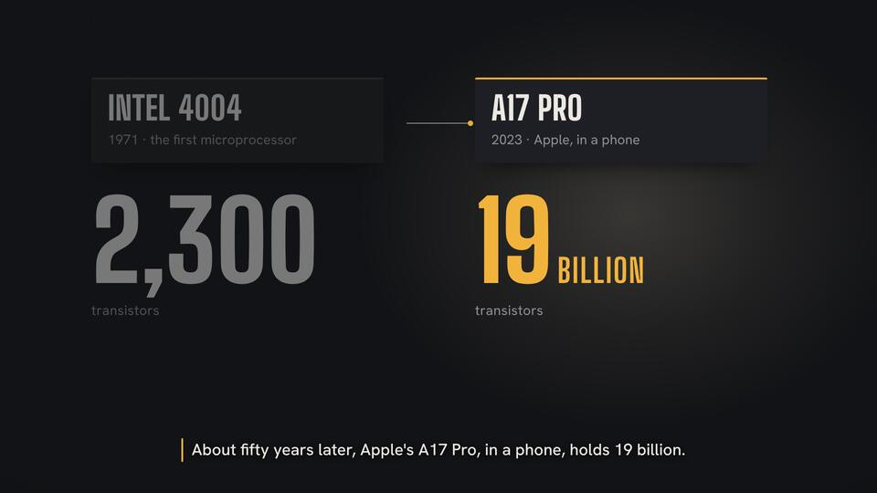
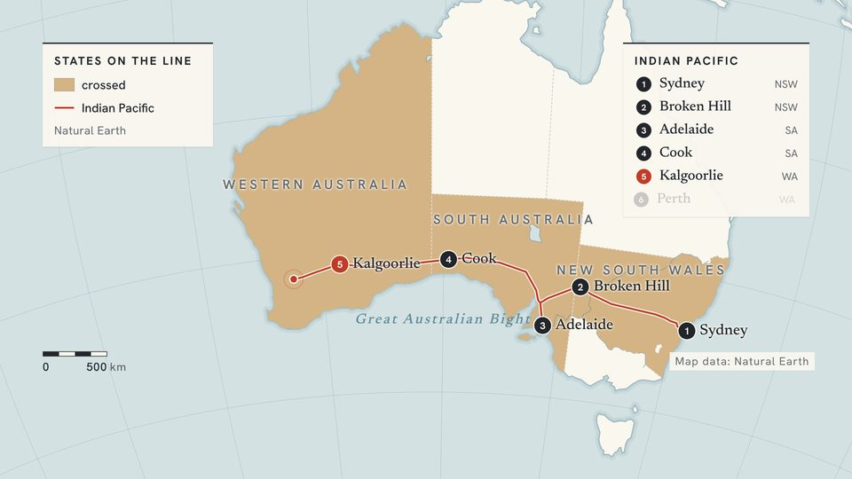
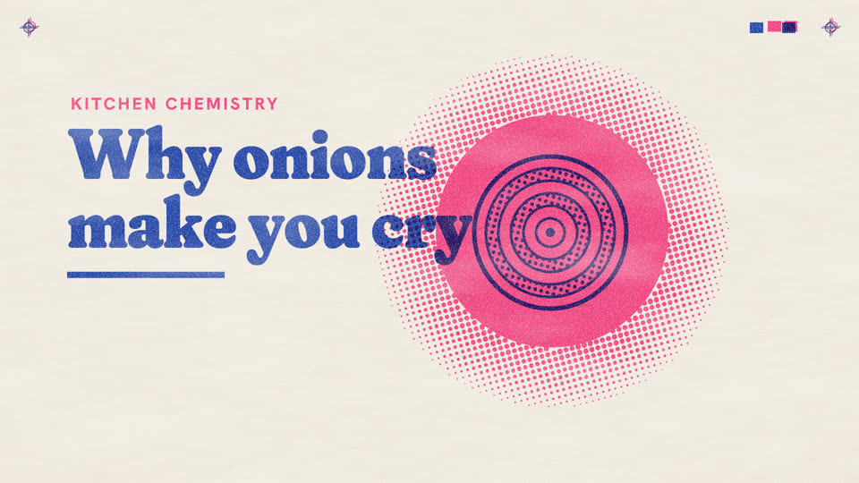
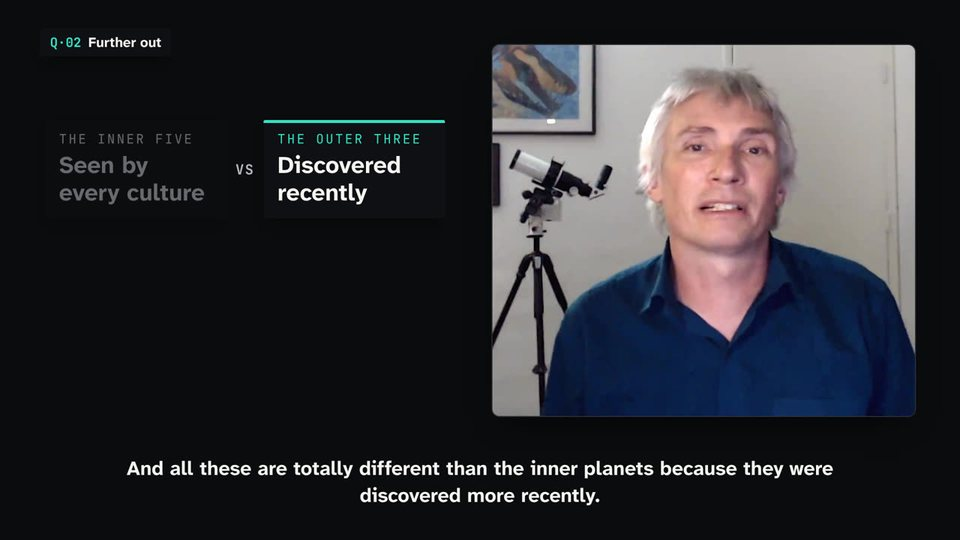

<div align="center">

<h1>
  <picture>
    <source media="(prefers-color-scheme: dark)" srcset="https://motionhub.dev/brand/logo-dark.svg">
    
  </picture>
</h1>

**讲解类、叙事类视频可以反复使用的外观与动法。**<br>
一套开放格式和一个公共目录：把片子长什么样、画面怎么动写下来，人或 agent 都能用任何引擎照着做出一部新片子。

[English](README.md) · **简体中文**

**[浏览 motion](https://motionhub.dev)** · [文档](https://motionhub.dev/docs/) · [规范](SPEC.md)

[](https://www.npmjs.com/package/@motionhub/cli)
[](https://github.com/motionhub-dev/motions/actions/workflows/check.yml)
[](SPEC.md)
[](LICENSE)

<table>
<tr>
<td width="25%" align="center"><a href="https://motionhub.dev/m/@iamsuosi/red-pencil/"></a><br><sub>红笔批注</sub></td>
<td width="25%" align="center"><a href="https://motionhub.dev/m/@iamsuosi/clay-world/"></a><br><sub>黏土小世界</sub></td>
<td width="25%" align="center"><a href="https://motionhub.dev/m/@iamsuosi/ink-scroll/"></a><br><sub>墨卷</sub></td>
<td width="25%" align="center"><a href="https://motionhub.dev/m/@iamsuosi/pixel-quest/"></a><br><sub>像素关卡</sub></td>
</tr>
<tr>
<td width="25%" align="center"><a href="https://motionhub.dev/m/@iamsuosi/stage-light/"></a><br><sub>聚光台</sub></td>
<td width="25%" align="center"><a href="https://motionhub.dev/m/@iamsuosi/field-atlas/"></a><br><sub>地图志</sub></td>
<td width="25%" align="center"><a href="https://motionhub.dev/m/@iamsuosi/riso-pop/"></a><br><sub>孔版双色</sub></td>
<td width="25%" align="center"><a href="https://motionhub.dev/m/@iamsuosi/on-air/"></a><br><sub>口播字条</sub></td>
</tr>
</table>

[**到 motionhub.dev 浏览全部 motion**](https://motionhub.dev)

<sub>本文和链接到的文档均以英文版为准，链接到的文档目前只有英文。</sub>

</div>

## 什么是 motion

每个 motion 都围绕一份 [`MOTION.md`](docs/motion-md.md) 写成。这是一种开放格式，用法和 `SKILL.md` 相似：它是一个目录的入口，说明一部片子长什么样、怎么动，并带上现成的组件，供 agent 优先使用。

Motion（风格）只管外观，不含片子：底色、配色、字体，以及画面元素怎么出现、变化和离开。它没有故事、脚本、场景和时间轴。故事由你来定，外观交给 motion，换什么引擎都一样。

## 快速开始

不用安装任何东西。挑一个 motion，把下面这段话粘贴给任何能打开网址的 agent：

```text
Read https://motionhub.dev/llms.txt, then make a film about "<你的主题>" in the motion @iamsuosi/red-pencil
```

想再省事一点，可以安装一次 skill，电脑上所有 agent 都能用：

```sh
npx skills add motionhub-dev/motions -g
```

然后直接说你想要什么：

| 这样说 | 会发生什么 |
|---|---|
| `/motionhub make a film about <你的主题> in @iamsuosi/red-pencil` | agent 取回这个 motion，核对 SHA-256，完整读完 `MOTION.md` 和 `tokens.json`，再用它手头的引擎照着这个外观做片 |
| `/motionhub make a Remotion film about <你的主题> in @iamsuosi/clay-world` | 同上，但用 Remotion，并用这个 motion 的组件和 token 来搭建 |
| `/motionhub share this project's look as a motion` | agent 从项目里提取外观写成 motion（不带片子的故事），跑完检查后给你看结果，你同意后才开 pull request |

也可以用命令行，需要 Node.js 20 或更高版本：

```sh
npx @motionhub/cli search hand-drawn          # 搜索含有所有关键词的 motion
npx @motionhub/cli get @iamsuosi/red-pencil   # 下载到 ./motion，并核对 SHA-256
```

所有用法见 [Use a motion](docs/use.md)，所有命令见 [Command line](docs/cli.md)。

## 一个 motion 长什么样

一个 motion 是一个目录，里面有五个文件；需要现成部件的工具，还可以各有一个自己的目录：

```
motions/@<scope>/<slug>/   一个 motion，id 为 @<scope>/<slug>：创作者的 GitHub 用户名加 slug
  motion.json     id、版本、名称、一句话介绍、作者和许可证
  MOTION.md       用文字写给人和 agent 看的外观：气质、配色、字体、动法、要避免什么
  tokens.json     精确的数值，采用 W3C 设计 token 格式：颜色、字体、时长、缓动
  poster.jpg      用它做的片子中的一帧
  CREDITS.md      用到的每个字体和素材，以及它们的许可证和来源
  react/          可选：能在任何 React 引擎里原样运行的组件
```

```json
{
  "spec": "motion/0.4",
  "scope": "iamsuosi",
  "slug": "red-pencil",
  "version": "1.0.5",
  "name": {"en": "Red Pencil", "zh-CN": "红笔批注"},
  "line": {"en": "A printed page marked up in red as it is read: figures circled, wrong sums struck and corrected, verdicts written in the margin."},
  "authors": [{"name": "SuoSi", "github": "iamsuosi"}],
  "license": {"text": "CC-BY-4.0", "code": "MIT"},
  "lang": "en",
  "tags": ["hand-drawn", "light"],
  "fit": {"kind": "general", "for": {"en": "Checking a document line by line: what a price is made of, contract terms, claims in an ad, numbers corrected."}}
}
```

每个文件具体写什么、工具可以依赖什么，见 [SPEC.md](SPEC.md)。`MOTION.md` 可以用任何语言写，`name` 和 `line` 可以同时提供多种语言。

## 引擎

同一个 motion 在任何引擎里都是同样的外观。

| 引擎 | 怎么用 motion | 指南 |
|---|---|---|
| **Remotion** | token 变成取值，`react/` 里的组件通过 [`@motionhub/remotion`](packages/remotion/README.md) 原样运行 | [Remotion](docs/remotion.md) |
| **HyperFrames** | token 变成 CSS 变量和缓动，`react/` 里的组件通过 [`@motionhub/hyperframes`](packages/hyperframes/README.md) 按你的时间轴绘制 | [HyperFrames](docs/hyperframes.md) |
| **其他任何引擎** | HTML 和 CSS、GSAP、Motion Canvas 或你自己的渲染器：照着 `MOTION.md` 和 `tokens.json` 做，就像照着一套设计规范做界面 | [Use a motion](docs/use.md#in-anything-else) |

两个绑定包都提供 [`@motionhub/runtime`](packages/runtime/README.md)。除了 React，motion 的组件只依赖它。

## 分享你的 motion

做了一部片子，觉得它的外观值得给别人用？装好 skill 后，在那个项目里对 agent 说：

```text
/motionhub share this project's look as a motion
```

也可以手动操作：

```sh
npx @motionhub/cli init <slug>         # 生成 ./<slug>/，含所有待填写的必需文件，scope 为你
npx @motionhub/cli share <slug>        # 以你的 GitHub 账号（gh）运行 pull request 会跑的检查
npx @motionhub/cli share <slug> --pr   # 从你的 fork 开 pull request，并带上 sign-off
```

你的 motion 会以 `@<你的 GitHub 用户名>/<slug>` 发布，也欢迎在别人的 motion 基础上继续创作。接受什么、怎么审核，见 [CONTRIBUTING.md](CONTRIBUTING.md)。

<details>
<summary><b>仓库里有什么</b></summary>

| 路径 | |
|---|---|
| [SPEC.md](SPEC.md) | motion 格式 |
| [CONTRIBUTING.md](CONTRIBUTING.md) | 怎么投稿一个 motion，接受什么，怎么审核 |
| [HUB.md](HUB.md) | 目录怎么发布、怎么取用 |
| [motions](motions) | 目录本身 |
| [skills/motionhub](skills/motionhub/SKILL.md) | agent skill：怎么挑选 motion、取到它、照着它做片，以及分享你自己的 motion |
| [bin](bin) · [tools](tools) | `@motionhub/cli`、写着所有规则的检查器，以及 motionhub.dev 所发布文件的构建脚本 |
| [packages](packages) | `@motionhub/runtime` 及其 Remotion、HyperFrames 绑定 |
| [docs](docs) | [motionhub.dev/docs](https://motionhub.dev/docs/) 上的指南 |
| [site](site) | motionhub.dev 的页面，是一个有独立依赖的 Astro 项目 |
| [brand](brand/BRAND.md) | logo、设计 token 及其用法 |
| [tests](tests) | 工具的测试 |

</details>

<details>
<summary><b>开发</b></summary>

仓库根目录是零依赖的 `@motionhub/cli` 包。push 之前运行：

```sh
npm test                                  # 工具的测试
node tools/check.mjs                      # 检查全部 motion
node tools/check.mjs motions/@<scope>/<slug>   # 或只检查一个
node tools/build.mjs                      # 生成 motionhub.dev 要发布的文件，放在 dist/
```

如果改了站点，在 `site/` 里运行：

```sh
npm ci && npm run build
```

每个 commit 都要 sign-off（`git commit -s`），否则 pull request 过不了检查。

</details>

## 状态

项目还处于早期。格式目前是草案，新版本只会增加内容，不会改变已发布版本的含义。想修改格式，请在本仓库提 [issue](https://github.com/motionhub-dev/motions/issues)。格式属于每一个使用它的人。

由 [SuoSi](https://github.com/iamsuosi) 维护。

## 许可

本仓库里的工具采用 [MIT](LICENSE) 许可。每个 motion 在自己的 `motion.json` 里声明各自的许可证。
